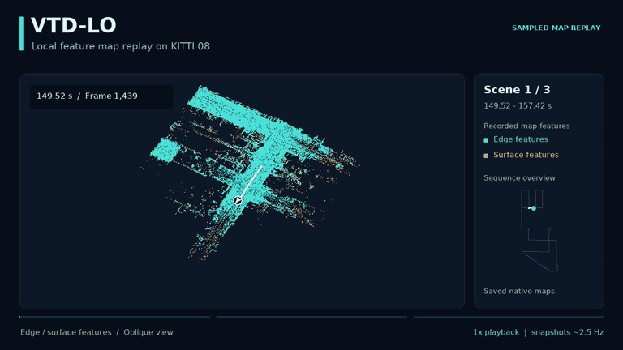
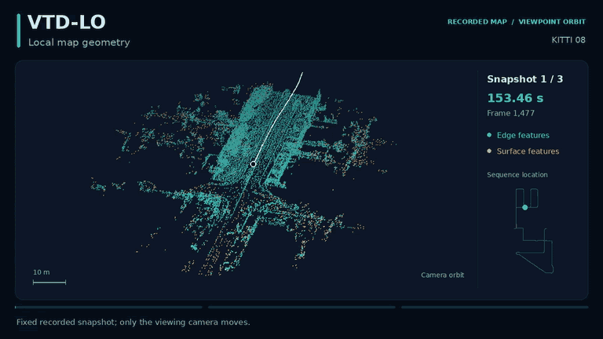
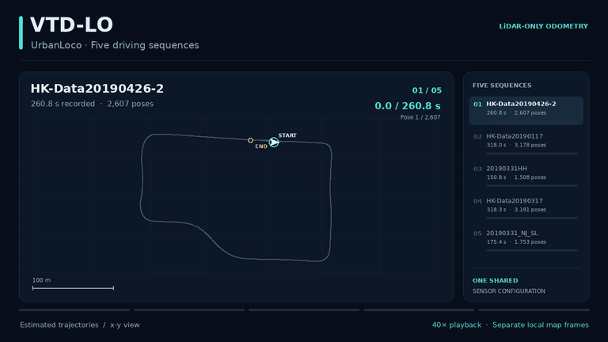
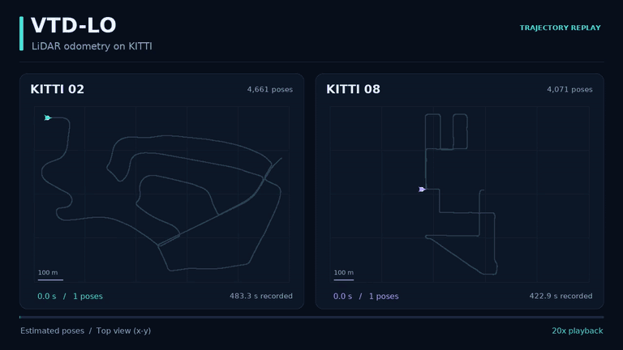

# VTD-LO

### Voxel-Temporal Dynamic Filtering LiDAR Odometry

VTD-LO estimates sensor motion from 3D LiDAR scans while maintaining a local feature map. Its voxel-temporal statistics identify geometrically unstable regions, and its adaptive residual weighting combines temporal stability, map-point age, and measurement range during scan-to-map registration. The system uses LiDAR geometry without semantic labels or an IMU.

[Demos](#demos) · [Method](docs/method.md) · [Build and run](docs/usage.md) · [ROS interfaces](docs/usage.md#ros-interfaces)

## Demos

### Temporal local-map replay · KITTI 08

<p align="center">
  
</p>

Three recorded time windows show the local feature maps used for registration, with the estimated pose and position along the route. Playback is at 1× recorded time; cyan denotes edge features and amber denotes surface features.

### Local-map geometry · KITTI 08

<p align="center">
  
</p>

A moving viewpoint reveals the spatial structure of three recorded local-map snapshots. Each point set remains fixed during its eight-second view, with a 10 m scale and a route locator.

### Five recorded runs · UrbanLoco

<p align="center">
  
</p>

Five UrbanLoco runs use one shared sensor configuration. Their saved pose estimates are replayed sequentially at 40×, with the current position, elapsed time, and sequence progress.

### Complete trajectory replay · KITTI 02 and 08

<p align="center">
  
</p>

The saved trajectories for KITTI 02 and 08 are replayed together at 20× recorded time.

[Recording details and sequence information](docs/demonstrations.md)

## Method

VTD-LO couples feature-to-map registration with a temporal model of local geometry. Edge and planar features form the registration map; repeated observations update separate voxel statistics for the two feature types.

| Component | Role in VTD-LO |
| --- | --- |
| **Voxel-temporal statistics** | Track geometric variation through online observation counts, means, and variances. |
| **Two-stage dynamic suppression** | Screen unstable correspondences during registration and remove unstable geometry during local-map updates. |
| **Adaptive residual weighting** | Combine voxel stability, map-point age, and measurement range into bounded weights for robust pose optimization. |

The temporal model follows observed geometry rather than semantic object categories. A stationary vehicle can contribute stable constraints without requiring an object detector. The system uses LiDAR geometry without IMU fusion or a loop-closure backend.

[Method and parameter reference](docs/method.md) · [ROS interfaces](docs/usage.md#ros-interfaces)

## Get started

The reference environment is **Ubuntu 20.04 with ROS Noetic**. The package uses **C++17, PCL, Eigen, and Ceres**.

Follow [Build and run](docs/usage.md) to install dependencies and create a catkin workspace. With the workspace sourced and `08.bag` placed in `~/DATASET/KITTI/`:

```bash
mkdir -p "$HOME/vtd_results"
roslaunch vtd_lo kitti.launch \
  seq:=08 \
  tum_path:="$HOME/vtd_results/kitti08.txt"
```

The launch file starts bag playback, odometry, mapping, and visualization. For M2DGR, provide a bag path:

```bash
roslaunch vtd_lo m2dgr.launch \
  bag_file:="/absolute/path/hall_01.bag" \
  tum_path:="$HOME/vtd_results/hall01.txt"
```

## Acknowledgements

VTD-LO builds on the LiDAR odometry work and open-source implementations of [LOAM](https://github.com/laboshinl/loam_velodyne), [A-LOAM](https://github.com/HKUST-Aerial-Robotics/A-LOAM), [F-LOAM](https://github.com/wh200720041/floam), and [PFilter](https://github.com/yjsx/PFilter). We thank their authors and contributors. VTD-LO develops voxel-temporal dynamic suppression and adaptive residual weighting within this feature-based odometry framework.

We also thank the teams behind [KITTI](https://www.cvlibs.net/datasets/kitti/eval_odometry.php), [UrbanLoco](https://github.com/weisongwen/UrbanLoco), and [M2DGR](https://github.com/SJTU-ViSYS/M2DGR) for making their datasets available. The demonstrations above use KITTI and UrbanLoco recordings.
