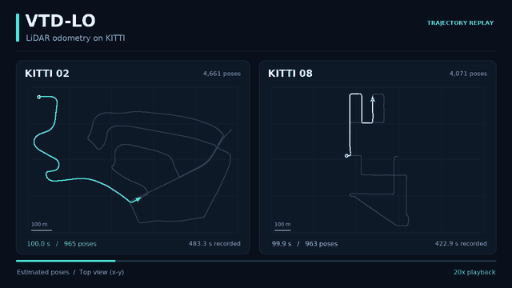
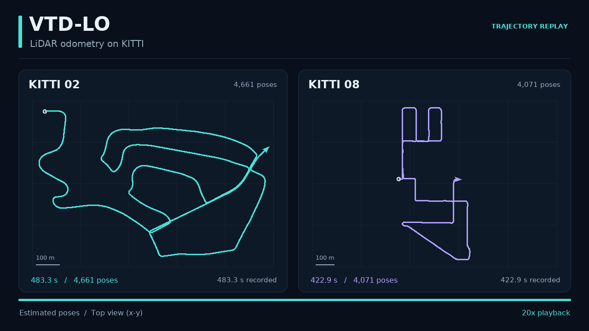
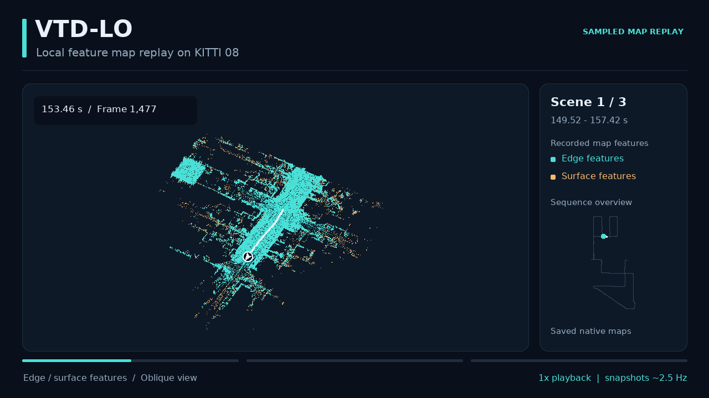
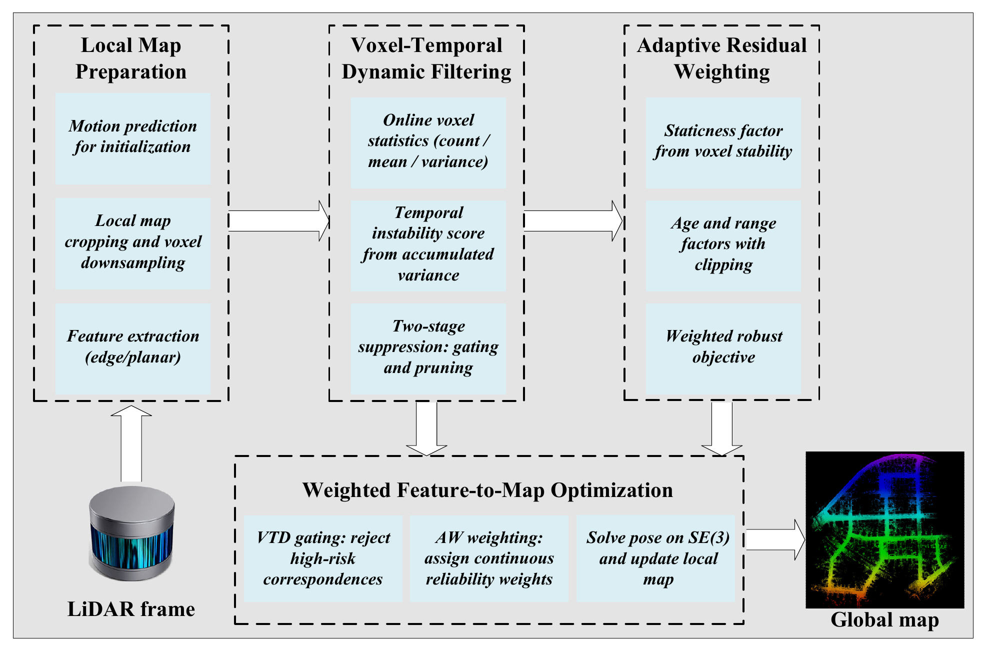

# VTD-LO

### 基于体素时序动态过滤的激光雷达里程计

VTD-LO 从三维激光雷达扫描中估计传感器运动，并维护局部特征地图。方法通过体素时序统计识别几何不稳定区域，在扫描与地图配准时，综合时序稳定性、地图点龄和量测距离对残差进行自适应加权。系统基于激光雷达几何信息工作，无需语义标签或 IMU 输入。

[English](README.md) · [演示](#演示) · [方法说明](docs/method.md) · [安装与运行](docs/usage.md) · [ROS 接口](docs/usage.md#ros-interfaces)

## 演示

<p align="center">
  <a href="https://qfwang23.github.io/VTD-LO/#trajectories"></a>
</p>

| 轨迹回放 | 局部特征地图回放 |
| :---: | :---: |
| [](https://qfwang23.github.io/VTD-LO/#trajectories) | [](https://qfwang23.github.io/VTD-LO/#local-map) |
| [观看视频](https://qfwang23.github.io/VTD-LO/#trajectories) | [观看视频](https://qfwang23.github.io/VTD-LO/#local-map) |

轨迹视频以记录时间的 20 倍速回放 KITTI 02 和 08 上保存的 VTD-LO 估计轨迹；局部地图视频展示 KITTI 08 三个短时间窗口中记录的特征地图快照。点击预览图可打开完整视频。

## 方法特点

- **持续跟踪几何稳定性。** 分别维护角点和平面体素状态，使用在线均值与方差更新汇总地图的重复观测。
- **在两个阶段抑制不稳定几何。** 体素状态同时用于配准中的对应关系筛选，以及局部特征地图更新中的不稳定点移除。
- **对保留的约束进行加权。** 结合时序稳定性、地图点龄和量测距离计算有界残差权重，并与鲁棒非线性优化配合。
- **提供完整的 ROS 使用入口。** 包含 KITTI 与 M2DGR 启动文件、实时里程计与特征地图话题、RViz 可视化，以及 TUM 格式轨迹导出。

时序模型关注几何在多次观测中的实际变化。物体类别不直接决定其标签：停驻车辆可以提供稳定几何；对于不稳定区域，也无需先识别其物体类别即可进行抑制。

## 处理流程

<p align="center">
  
</p>

系统首先将激光扫描组织为扫描线并提取边缘和平面特征，再用运动预测初始化扫描与地图配准。优化器利用带有体素时序状态的局部特征地图选择几何约束并设置权重。估计位姿将新特征转换到地图坐标系，随后更新局部地图及其时序状态。

时序统计量、残差权重与配置含义见[方法与参数说明](docs/method.md)。

## 快速开始

参考环境为 **Ubuntu 20.04 + ROS Noetic**，依赖 **C++17、PCL、Eigen 和 Ceres**。

按照[安装与运行说明](docs/usage.md)准备依赖及 catkin 工作区。加载工作区环境后，将 `08.bag` 放入 `~/DATASET/KITTI/`，执行：

```bash
mkdir -p "$HOME/vtd_results"
roslaunch vtd_lo kitti.launch \
  seq:=08 \
  tum_path:="$HOME/vtd_results/kitti08.txt"
```

启动文件会自动启动数据回放、里程计、建图及可视化。运行 M2DGR 时指定数据路径：

```bash
roslaunch vtd_lo m2dgr.launch \
  bag_file:="/absolute/path/hall_01.bag" \
  tum_path:="$HOME/vtd_results/hall01.txt"
```

## 地图示例

| KITTI 02 | KITTI 08 |
| :---: | :---: |
|  |  |

## 目录

```text
VTD-LO(main)/src/vtd_lo/   ROS 功能包：节点、头文件、启动文件与 RViz 配置
assets/demos/             演示视频与预览图
assets/figures/           方法流程图
docs/                    方法、参数、安装与使用说明
result/                  地图与轨迹图
```

## 致谢

VTD-LO 基于 [LOAM](https://github.com/laboshinl/loam_velodyne)、[A-LOAM](https://github.com/HKUST-Aerial-Robotics/A-LOAM)、[F-LOAM](https://github.com/wh200720041/floam) 和 [PFilter](https://github.com/yjsx/PFilter) 的激光雷达里程计研究与开源实现，感谢相关作者及贡献者。在这一基于特征的里程计框架中，VTD-LO 进一步实现了体素时序动态抑制与自适应残差加权。

同时感谢 [KITTI](https://www.cvlibs.net/datasets/kitti/eval_odometry.php) 和 [M2DGR](https://github.com/SJTU-ViSYS/M2DGR) 团队公开数据集。上述演示使用 KITTI 数据制作。
